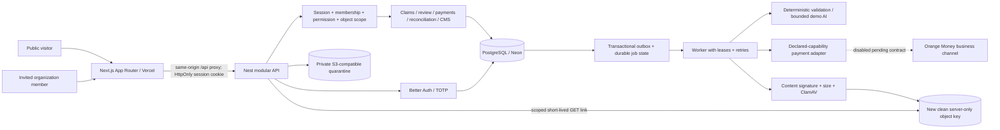
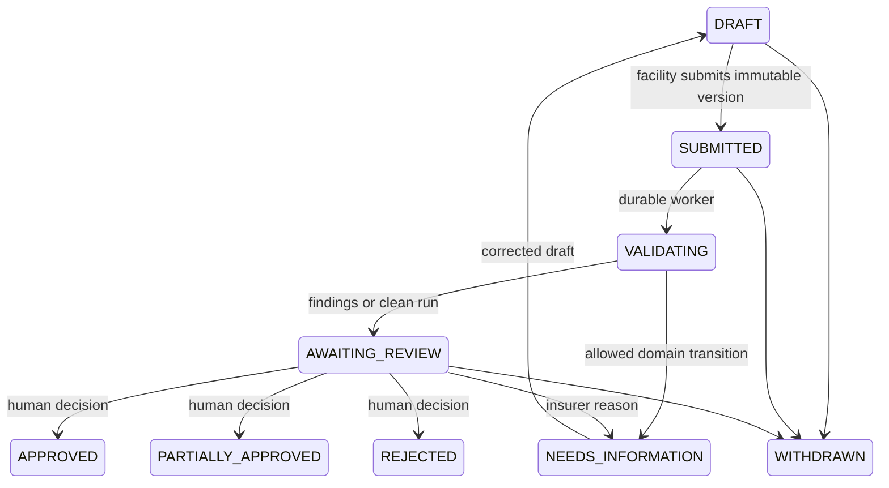
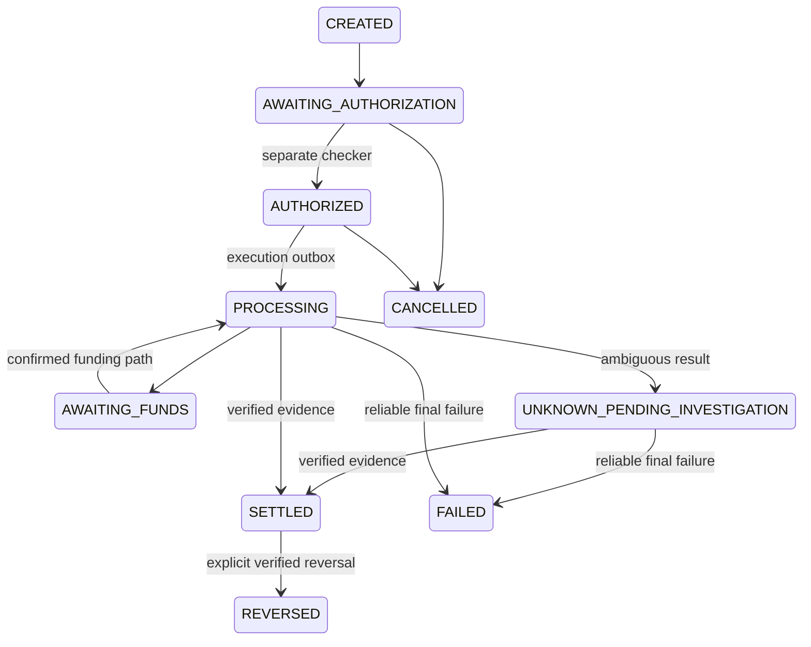

# Architecture and data flow

## Boundaries

- UI components never authorize decisions, recompute authoritative payable remainders or confirm settlement.
- Every authenticated domain request has one organization context (`X-Organization-ID`), checked against an active database membership. Headers do not confer access.
- Claims belong to both facility and insurer under a permitted contract. Finance serialization deliberately omits patient identifiers, encounters, items, findings and decision reasons.
- No global platform-admin clinical bypass. Audit and CMS permissions are separate from clinical/reviewer permissions.
- `packages/domain` centralizes money, permissions, schemas and allowed states. `packages/db` owns transactions. API services own workflow and explicit SQL scoping.
- Database state is authoritative; UI polling refetches on focus/reconnect. There is no unscoped realtime broadcast service.
- Domain mutations and outbox insertion share a transaction. A worker crash does not discard submitted claims. Processing errors are distinguishable from validation findings.

## Claim state diagram

Withdrawal is available to the submitting facility before conflicting decisions or payments and retains submitted history. Appeals are separate records and do not rewrite the original decision. Appeal review records an outcome narrative; changing an already payable decision requires an approved adjustment workflow, not an unsafe direct edit.

## Payment state diagram

The UI does not expose an unsafe arbitrary state editor. Pre-execution cancellation releases only an undispatched reservation; dispatched or unknown payments require provider-confirmed outcomes. Funding release and financial adjustments require further operator-approved command surfaces before live operation. Unknown results cannot be sent through execution again.
